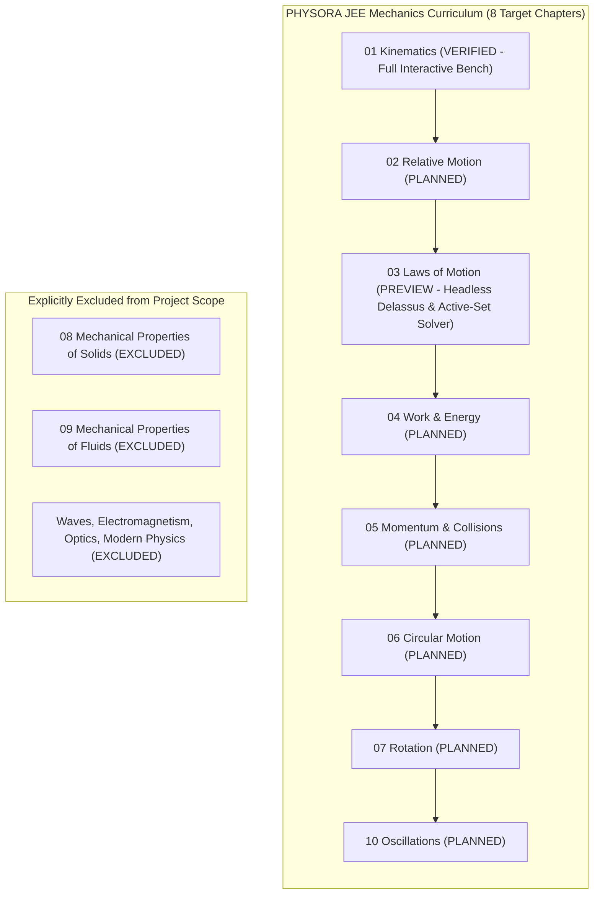
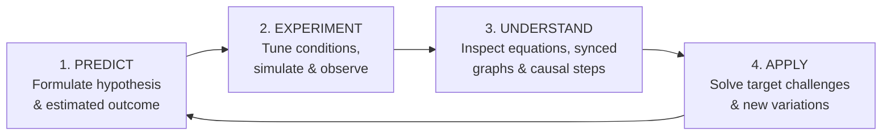
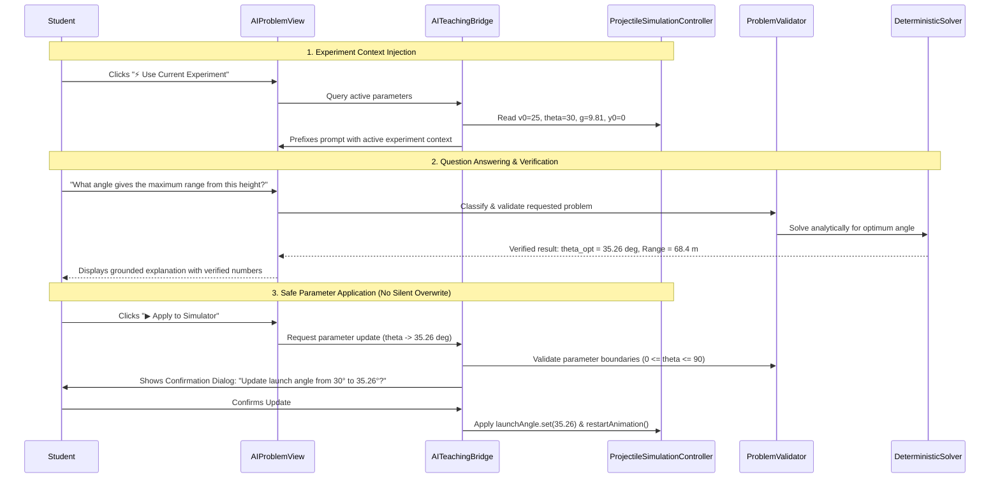
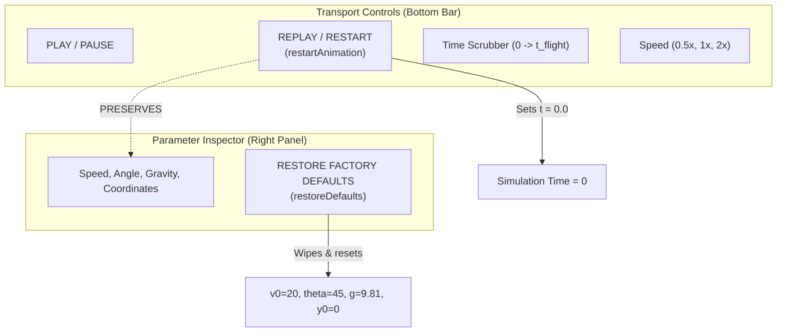

# PHYSORA — Product & Implementation Blueprint

**Document Version:** 1.1.0  
**Status:** Approved & Frozen Product & Technical Specification  
**Location in Repository:** `docs/PHYSORA_PRODUCT_AND_IMPLEMENTATION_BLUEPRINT.md`  
**Baseline Git Checkpoint:** `34e44e2` (`feature/physora-demo-development`, 2026-11-15)  
**Verified Test Baseline:** 367 / 367 automated tests passing  

---

## 1. Frozen Product Vision

> **PHYSORA is an interactive physics learning laboratory for Class 11 and 12 students preparing for JEE Main and Advanced. It allows students to predict physical outcomes, conduct virtual experiments, visualize mathematical relationships, solve problems, and understand the underlying physics through guided explanations.**

PHYSORA is not a generic game-physics sandbox, nor is it a passive question bank or an abstract equation dump. It is an active educational laboratory designed to turn abstract mathematical physics into tangible, experimentally verifiable cause-and-effect understanding.

### Non-Negotiable Core Decisions
1. **Eight Mechanics Chapters Only:** Scope is strictly bounded to the core JEE mechanics sequence.
2. **Solids and Fluids Excluded:** Mechanical Properties of Solids (08) and Fluids (09) are explicitly outside this project scope.
3. **Student Experience Takes Priority:** A student evaluates software by clarity, responsiveness, and pedagogical guidance—not by backend matrix complexity.
4. **Kinematics is the First Complete Experience:** Perfect one chapter end-to-end before expanding breadth.
5. **Deterministic Java Physics as the Sole Numerical Authority:** Every accepted number, coordinate, and state vector is calculated by verified Java algorithms.
6. **AI as an Experiment-Aware Teaching Companion:** AI interprets text, guides conceptual reasoning, and explains results, but never computes answers or silently modifies experiments.
7. **Pedagogical Consistency Across Diverse Models:** Every chapter follows the **Predict $\to$ Experiment $\to$ Understand $\to$ Apply** learning cycle, while utilizing domain-appropriate physics formulations.
8. **Scope Discipline:** No feature or chapter is added without an explicit educational rationale, mathematical specification, and test plan.

---

## 2. Frozen Eight-Chapter Curriculum Scope & Support Levels

To avoid premature claims of completeness, PHYSORA enforces a transparent **Capability Support Level Taxonomy**:

- **`VERIFIED`:** Fully implemented mathematical model, deterministic solver, interactive UI workbench, and automated test suite.
- **`SIMULATED`:** Working physics engine/time-stepping model verified in backend tests; UI visualization in progress.
- **`AI-GUIDED`:** Canonical question interpretation and grounded solver verified; interactive visual simulation pending.
- **`PREVIEW`:** Foundational mathematical classes and structural representations implemented; awaiting solver and workbench integration.
- **`PLANNED`:** Pedagogical specification defined; implementation scheduled for later phases.



### Curriculum Status Matrix

| Chapter ID | Chapter Name | Support Level | Implemented Capabilities & Next Milestone |
|---|---|---|---|
| **01** | **Kinematics** | **`VERIFIED`** | Analytical SI projectile motion, flat/inclined surfaces, structured AST solver, interactive JavaFX bench, AI interpretation/explanation. Milestone 1–3 focus. |
| **02** | **Relative Motion** | **`PLANNED`** | Reference frame switching ($\vec{r}_{A/B} = \vec{r}_A - \vec{r}_B$), river-boat drift/crossing, rain-umbrella problems, 2-projectile pursuit. |
| **03** | **Laws of Motion** | **`PREVIEW`** | Backend mass-whitened Delassus RRQR solver (`DelassusRrqrSolver`) and unilateral active-set cable solver (`UnilateralActiveSetSolver`) fully verified (56 targeted tests). UI workbench pending Phase C. |
| **04** | **Work & Energy** | **`PLANNED`** | Work-energy theorem, conservative fields, real-time $K, U_g, U_s, W_{nc}$ energy bars, potential energy wells $U(x)$, stability analysis. |
| **05** | **Momentum & Collisions** | **`PLANNED`** | Center-of-mass kinematics, 1D/2D elastic & inelastic collisions ($0 \le e \le 1$), impulse curves, zero-momentum frame transformation. |
| **06** | **Circular Motion** | **`PLANNED`** | Kinematics ($\omega, \alpha$), centripetal/tangential acceleration vectors, banked tracks, vertical circular motion loop-the-loop tension dynamics. |
| **07** | **Rotation** | **`PLANNED`** | Rigid-body rotation $\tau = I\alpha$, angular momentum, pure rolling vs. slipping on inclines, moment of inertia visual races. |
| **10** | **Oscillations** | **`PLANNED`** | Simple Harmonic Motion (SHM), spring-mass series/parallel configs, simple pendulum, phase-space orbits ($v$ vs. $x$), energy exchange. |
| *08* | *Solids* | **`EXCLUDED`** | Stress-strain curves, elastic moduli, Hooke's continuum law. Out of scope. |
| *09* | *Fluids* | **`EXCLUDED`** | Hydrostatics, Pascal's law, Bernoulli equation, viscosity. Out of scope. |

---

## 3. Student Personas & Pedagogical Learning Workflow

PHYSORA addresses three distinct student personas within the Class 11–12 and JEE preparation spectrum:

### Student Personas
1. **The Intuition Builder (Class 11 Beginner):**
   - *Needs:* Direct visual connection between parameters and physical behavior.
   - *Pain Point:* Confused by vector decomposition and sign conventions; memorizes formulas without understanding parameter sensitivity.
2. **The JEE Main Aspirant (Speed & Variation Recognition):**
   - *Needs:* Rapid exploration of parameter variations.
   - *Pain Point:* Over-focuses on standard symmetric formulas ($R = \frac{v^2\sin 2\theta}{g}$) and stumbles when launch and landing elevations differ ($y_0 \ne y_{\text{land}}$).
3. **The JEE Advanced Solver (Rigorous Multi-Condition Analysis):**
   - *Needs:* Step-by-step verification of boundary conditions, non-standard constraints, and multi-step derivations.
   - *Pain Point:* Textbooks provide final answers with skipped intermediate steps, making it difficult to locate where conceptual reasoning broke down.

### The Universal Four-Stage Learning Loop
Every chapter and interactive bench in PHYSORA structures its user experience around this four-stage cognitive cycle:



1. **PREDICT:** Before running a simulation, the student is prompted with a conceptual or quantitative prediction (e.g., *"If launch height is doubled, will time of flight double, more than double, or less than double?"*).
2. **EXPERIMENT:** The student executes the experiment, scrubs the timeline, modulates physical parameters, and directly observes the empirical physical trajectory and event markers.
3. **UNDERSTAND:** The student opens the step-by-step logic view and synchronized graphs ($y-t$, $v_y-t$). They see the analytical derivation unfold: **Given $\to$ Governing Principle $\to$ Formula $\to$ Substitution $\to$ Evaluated Result**.
4. **APPLY:** The student takes on a goal-oriented challenge (e.g., *Hit the Target*, *Achieve Optimum Landing Speed*, or solve a JEE problem using the AI Teaching Companion).

---

## 4. Reusable Platform Architecture (Domain-Appropriate Modeling)

Rather than forcing every chapter into an identical monolithic physics engine, PHYSORA separates **shared educational infrastructure** from **chapter-specific physics formulations**:


### Shared Platform Infrastructure
1. **Simulation Harness:** Lifecycle management, animation timer pacing, rate scaling ($0.25\times$ to $2.0\times$), timeline scrubbing, non-destructive restart, and clean state restoration.
2. **Synchronized Graphing System:** 2D plotting engine generating synchronized curves ($x-t, y-t, v_y-t, E-t$) with a scrub-linked needle indicating the active simulation timestamp.
3. **Pedagogical Logic Engine:** Four-stage instructional derivation cards:
   $$\text{Stage 1: Given Quantities} \longrightarrow \text{Stage 2: Governing Principle} \longrightarrow \text{Stage 3: Symbolic Substitution} \longrightarrow \text{Stage 4: Evaluated Answer}$$
4. **Experiment Manager (Presets & Comparison):**
   - **Preset Library:** Standard pedagogical configurations (*Maximum Range 45°*, *Cliff Launch*, *Different Angles Same Speed*, *Earth vs Moon Gravity*).
   - **Trajectory Comparison:** Caches Trajectory A in memory, allows parameter adjustment to create Trajectory B, and renders Trajectory A as a translucent reference overlay with delta metrics ($\Delta R, \Delta H, \Delta T$).
5. **Challenge Engine:** Manages prediction hypotheses and target-hit scoring.
6. **AI Teaching Bridge:** Standardized interface passing active parameters to the AI conversation service and handling validated student-confirmed parameter updates.

### Domain-Appropriate Physics Modeling
Each chapter implements the mathematical representation best suited to its physical domain:
- **Kinematics:** Analytical closed-form parametric functions ($x(t), y(t)$) for perfect numerical precision and instantaneous root-finding.
- **Relative Motion:** Analytical vector frame transformations ($\vec{r}_{A/B} = \vec{r}_A - \vec{r}_B$) and parametric pursuit curves.
- **Laws of Motion:** Semi-implicit symplectic numerical integration coupled with the mass-whitened Delassus RRQR solver (`DelassusRrqrSolver`) for constrained multi-body systems.
- **Work & Energy:** State-function energy accounting ($E = K + U$) and numerical work integrals.
- **Momentum & Collisions:** Momentum conservation equations, center-of-mass kinematics, and restitution jump conditions.
- **Circular Motion & Rotation:** Angular state variables ($\theta, \omega, \alpha$) and coupled translational-rotational Newton-Euler equations.
- **Oscillations:** Harmonic state oscillators, phase-space state vectors, and numerical ODE integration.

---

## 5. Mathematically Safe AI Teaching Companion

The AI integration must strictly serve pedagogical exploration while maintaining zero risk of silent model corruption or hallucinated numerical answers.



### AI Safety Invariants
1. **Deterministic Numerical Authority:** The AI LLM generates *explanations and interpretations only*. All numerical values displayed in solution cards originate exclusively from `ProjectileProblemSolver` and `ProjectileMotion`.
2. **Explicit Student Confirmation for Parameter Changes:** When the AI suggests an experimental configuration (e.g., *"Try setting angle to 35.26°"*), clicking **Apply to Simulator** presents an explicit confirmation card showing current vs. proposed values. **The AI is strictly prohibited from silently modifying simulator state.**
3. **Rigorous Input Validation:** Any parameter suggested by AI and confirmed by the student must pass `ProblemValidator` range and finiteness checks before updating controller properties.
4. **Attribution Transparency Without Clutter:** Developer controls (`ProviderMode`, Ollama settings) are tucked into an expandable `[⚙ Advanced Settings]` drawer, leaving the visible interface clean, focused, and distraction-free.

---

## 6. Visual Readability & Adaptive Viewport Specification

The renderer's primary requirement is **visual readability**, ensuring that trajectories across 2 orders of magnitude (from $v_0 = 1\text{ m/s}$ to $v_0 = 100\text{ m/s}$) are instantly comprehensible and aesthetically polished.

### 1. Removing the Hardcoded 2.0-Metre Floor
In `ProjectileCanvasRenderer.java`, replace lines 63–64 with an adaptive bounding algorithm:
```java
double xSpan = Math.max(0.1, maxX - minX);
double ySpan = Math.max(0.1, maxY - minY);
```

### 2. Viewport Geometry & Aspect Ratio Management
- **Margins:** Top = 32px, Bottom = 52px, Left = 68px, Right = 32px.
- **Padding Factor:** Add 12% padding above maximum height and 10% padding beyond maximum range to prevent markers from touching borders.
- **Dynamic Grid Sizing:** Grid step lines must not use fixed counts (e.g. 8x6). Use standard 1-2-5 decade steps ($\dots, 0.2, 0.5, 1, 2, 5, 10, 20, 50, \dots$ meters) so grid intervals always represent clean, readable metric units regardless of zoom.

### 3. Event Marker Decluttering
- **Marker Collision Detection:** Calculate screen coordinates for the `LAUNCH`, `APEX`, and `LANDING` badges.
- **Vertical / Horizontal Offsetting:** If the distance between `APEX` and `LANDING` badges is $< 48$ screen pixels (common in low-angle or low-speed launches):
  - Stagger `APEX` badge 16px higher.
  - Stagger `LANDING` badge 12px lower.
  - Suppress duplicate overlapping coordinate labels while retaining badge points.

### 4. Interactive "Fit Trajectory" Action
- Add a prominent **`[🔍 Fit Trajectory]`** button on the canvas toolbar.
- Clicking automatically computes the tightest bounding box containing $(x_0, y_0)$, $(x_{\text{apex}}, y_{\text{apex}})$, $(x_{\text{land}}, y_{\text{land}})$, and the entire sampled trajectory, resetting pan/zoom to optimal focus.

---

## 7. Decoupled Playback: Restart vs. Defaults

To prevent accidental loss of student experiments, animation playback is strictly decoupled from parameter state:



- **`restartAnimation()` (Primary Transport Action):** Sets `simulationTime.set(0.0)`, pauses animation, and **strictly preserves** all tuned user parameters ($v_0, \theta, g, x_0, y_0, y_{\text{land}}$).
- **`restoreDefaults()` (Secondary Inspector Action):** Explicitly styled button labeled "Restore Defaults" with confirmation prompt if parameters were modified from standard factory settings.

---

## 8. Non-Destructive Number Field Input Handling

To eliminate typing-induced animation resets and false error flashes:
1. **Commit on Action / Focus Lost:** `TextField` updates the underlying `DoubleProperty` only when the student presses **Enter** or clicks outside the field (**focus lost**).
2. **Debounced Validation Feedback:** While the student is actively typing, perform non-blocking syntax validation:
   - If text is intermediate (e.g. empty, `-`, `.`), do not show validation error badges or reset model.
   - If invalid text remains after focus is lost, highlight the field with `.input-invalid` and restore the last valid value on **Escape**.
3. **Sliders Remain Live:** Sliders continue to update the model in real time during drag gestures.

---

## 9. 48-Hour Demonstration Plan with Built-In Contingency

The 48-hour schedule is organized into discrete, independently testable milestones with explicit contingency buffers:

```mermaid
gantt
    title PHYSORA 48-Hour Demo Sprint Timeline (With Buffer)
    dateFormat HH:mm
    axisFormat %H:%M

    section Milestone 1 (P0 Fixes)
    Adaptive Scaling & Fit Trajectory :m1a, 00:00, 4h
    Decouple Restart vs Defaults :m1b, after m1a, 3h
    AI Experiment Context Bridge :m1c, after m1b, 4h

    section Milestone 2 (P1 Polish)
    Input Typing Enter/Blur Handling :m2a, after m1c, 3h
    Instructional Logic Card (Given->Answer) :m2b, after m2a, 5h
    AI Advanced Settings Collapse :m2c, after m2b, 2h
    Sidebar 8-Chapter Alignment & CSS Overhaul :m2d, after m2c, 4h

    section Milestone 3 (Signature Features)
    Predict Before You Simulate :m3a, after m2d, 5h
    Compare Two Experiments Overlay :m3b, after m3a, 6h

    section Milestone 4 (Verification & Buffer)
    Automated Regression (367 Tests + New) :m4a, after m3b, 4h
    UI Walkthrough & Contingency Buffer :m4b, after m4a, 8h
```



### Prioritized Milestone Breakdown

#### Milestone 1: Kinematics Stability (P0 — Immediate)
- **1.1 Adaptive Scaling & Fit Trajectory:** Remove 2.0m clamp, implement dynamic padding, grid decades, and Fit button.
- **1.2 Decouple Restart vs. Restore:** Implement `restartAnimation()` preserving parameters; move `restoreDefaults()` to inspector.
- **1.3 AI Experiment Context Bridge:** Wire `controller` into `AIProblemView`, add `[⚡ Use Current Experiment]` button.
- *Verification:* Low/high-velocity manual checks + existing test suite passes.

#### Milestone 2: Student Experience (P1 — Core Usability)
- **2.1 Non-Destructive Number Fields:** Commit on Enter/unfocus; live sliders preserved.
- **2.2 Guided 4-Stage Logic Card:** Redesign `ProjectileLogicView` into **Given $\to$ Principle $\to$ Formula $\to$ Substitution $\to$ Answer** card with target selector.
- **2.3 De-Clutter AI Interface:** Move provider settings into `Advanced Settings` drawer; clean status pills for attribution.
- **2.4 8-Chapter Navigation & CSS:** Update `ChapterRail` to display the frozen 8 chapters; upgrade font sizes to 12px–14px.
- *Verification:* Automated UI tests via `FxTestRuntime`.

#### Milestone 3: Signature Educational Features (P2 — Distinctive Pedagogy)
- **3.1 Predict Before You Simulate:** Interactive hypothesis prompt before launch with post-flight explanation.
- **3.2 Compare Two Experiments (Contingency Feature):** Reference Trajectory A overlay with delta summary card ($\Delta R, \Delta H, \Delta T$). If time or stability is constrained, deliver Predict first.

#### Milestone 4: Verification, Regression & Demonstration Readiness
- Run full 367-test suite plus new targeted tests via `.\mvnw.cmd test`.
- Visual walkthrough on Windows desktop.
- 8-hour contingency buffer reserved for edge-case polishing and demo rehearsals.

---

## 10. Test and Verification Strategy

1. **Test Preservation Invariant:** The existing **367 automated tests** across Phase 1, Phase 2, and Phase 3 must remain 100% passing at all times.
2. **Analytical vs. Numerical Invariants:**
   - Analytical models (`ProjectileMotion`) must match closed-form formulas within $10^{-9}$ tolerance.
   - Symplectic integrators and constraint solvers (`UnilateralActiveSetSolver`) must satisfy complementarity within defined tolerances ($w \ge -\epsilon_w, \lambda \ge 0$).
3. **Headless UI Testing:** All JavaFX controller and view enhancements must be verified using `FxTestRuntime` on the FX application thread to guarantee headless build compatibility in Surefire.
4. **No Unverified AI Answers:** Test suites will confirm that AI suggestions continue to be verified against `SolutionVerifier` and `ExplanationVerifier` before any output is shown.

---

## 11. Approval & Governance

This blueprint authoritatively governs PHYSORA development on branch `feature/physora-demo-development`. All implementation pull requests and milestones must trace their changes directly to the requirements in this document.

